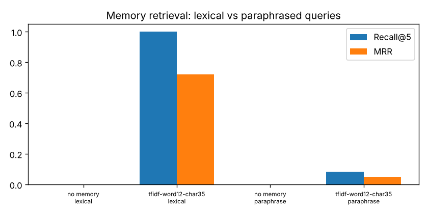
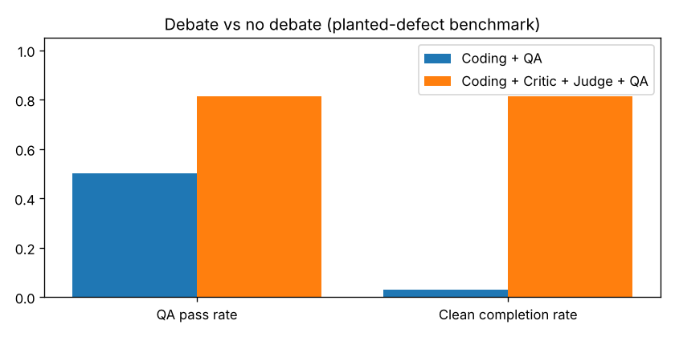
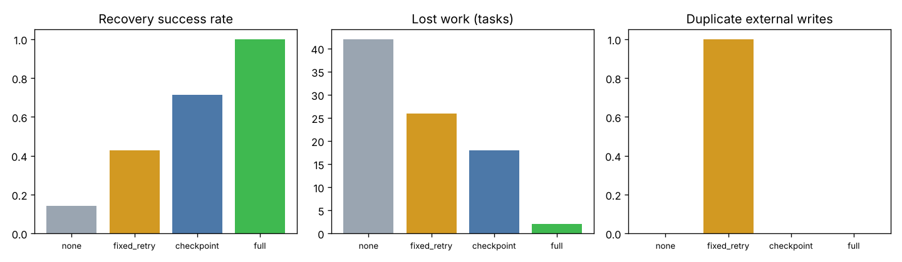

# AegisFlow AI — Enhancement Evaluation

Generated by `scripts/evaluate_enhancements.py`. All numbers come from executed runs; simulated components are labelled.

## 1. RAG memory retrieval

Labelled benchmark: 140 verified memories (28 features x 5 categories), 280 queries per set; one relevant memory per query.

| backend | queries | Recall@1 | Recall@5 | MRR | latency ms | context tokens / task |
|---|---|---|---|---|---|---|
| no memory | lexical | 0.0 | 0.0 | 0.0 | 0.0 | 0 |
| tfidf-word12-char35-v1+faiss | lexical | 0.5071 | 1.0 | 0.7213 | 1.838 | 98 |
| sentence-embeddings (unavailable) | lexical | - | - | - | - | ProxyError: model could not be loaded in this environment |
| no memory | paraphrase | 0.0 | 0.0 | 0.0 | 0.0 | 0 |
| tfidf-word12-char35-v1+faiss | paraphrase | 0.0321 | 0.0821 | 0.0495 | 1.433 | 99 |
| sentence-embeddings (unavailable) | paraphrase | - | - | - | - | ProxyError: model could not be loaded in this environment |

**Reading.** TF-IDF retrieves well when wording overlaps (lexical) but collapses on paraphrases, which is the case sentence embeddings are designed for. Run this script where the embedding model can be downloaded to fill the embedding rows.

End-to-end (same requirements, memory off vs on):

| condition | dev tasks | first-attempt success | memory hits | avg context tokens |
|---|---|---|---|---|
| memory_off | 14 | 1.0 | 0 | 0.0 |
| memory_on | 14 | 1.0 | 30 | 260.2 |

_With the deterministic template backend the generated code does not depend on prompt context, so memory cannot change task success here; it adds prompt tokens. Its effect on success must be measured with an LLM backend._

## 2. Predictive failure detection

Data: **SYNTHETIC execution history** (10,912 executions, 800 workflows); GroupShuffleSplit by workflow (train/val/test).

| target | model | PR-AUC | dummy PR-AUC | precision | recall | F1 | Brier (cal.) | Brier (uncal.) | Brier (dummy) | FPR |
|---|---|---|---|---|---|---|---|---|---|---|
| task_failed | logistic_regression | 0.3616 | 0.2063 | 0.3124 | 0.5927 | 0.4092 | 0.1533 | 0.1536 | 0.1638 | 0.3391 |
| deadline_missed | xgboost | 0.7846 | 0.3305 | 0.6325 | 0.8014 | 0.707 | 0.1364 | 0.134 | 0.2214 | 0.2299 |

**Limitations.** No provided real dataset contains agent execution outcomes, so the model learns a documented simulator. Live executions are recorded in `execution_metrics` for retraining (`prepare_failure_dataset(source='live')`). Task failure is intrinsically noisy in the simulator; deadline misses are more predictable (driven by slack and workload).

## 3. AI agent debate

Benchmark: 8 implementation tasks x 4 planted-defect variants (incl. none), same inputs in both conditions. Backend: static critic + template developer (no API cost). Completion = QA tests pass AND no blocking/major static-review issue remains.

| condition | runs | QA pass rate | clean completion | defects escaping QA | revisions | latency ms | tokens | API cost $ |
|---|---|---|---|---|---|---|---|---|
| no_debate | 32 | 0.5 | 0.0312 | 15 | 0.0 | 714.8 | 0.0 | 0.0 |
| debate | 32 | 0.8125 | 0.8125 | 0 | 0.969 | 955.5 | 300.3 | 0.0 |

By planted defect (QA pass rate / clean rate):

| defect | no debate: QA | no debate: clean | debate: QA | debate: clean |
|---|---|---|---|---|
| none | 1.0 | 0.125 | 1.0 | 1.0 |
| untested_placeholder | 1.0 | 0.0 | 1.0 | 1.0 |
| removed_validation | 0.0 | 0.0 | 0.25 | 0.25 |
| unsafe_import | 0.0 | 0.0 | 1.0 | 1.0 |

**Reading.** Unit tests alone let structural defects through (an untested placeholder function passes QA). The Critic catches those and the revision repairs them, at the cost of extra latency (~+35%). Debate is not free and is not a substitute for tests: the Judge only forwards work to QA.

**Limitations found by this benchmark.** (1) The static critic detects removed input validation only when *no* `raise` statement remains; modules that still raise elsewhere (CRUD/config) slip through, hence 0.25 on that row - an LLM critic is needed for semantic checks. (2) The clean-completion criterion also counts public classes never referenced by tests (e.g. a dataclass) as a major issue, which is why unmodified template code scores 0.125 without debate; the debate fixes this only with existence/callability contract tests, not behavioural tests.

## 4. Self-healing recovery (simulated faults)

7 injected scenarios per strategy on the same 8-task workflow (fault-free baseline 7.27 s). All faults are injected (simulated). 'recovered' for repeated_failure means it was escalated to a human rather than silently dropped.

| strategy | recovery success | workflow completion | MTTR ms | lost work (tasks) | duplicate writes | lost-response PR trial | extra attempts |
|---|---|---|---|---|---|---|---|
| none | 0.1429 | 0.1429 | None | 42 | 0 | failed | 0 |
| fixed_retry | 0.4286 | 0.4286 | 61.6 | 26 | 1 | ok | 8 |
| checkpoint | 0.7143 | 0.5714 | 53.0 | 18 | 0 | escalated_for_reconciliation | 9 |
| full | 1.0 | 0.8571 | 44.5 | 2 | 0 | escalated_for_reconciliation | 16 |

Per-scenario outcome (recovered?):

| scenario | none | fixed_retry | checkpoint | full |
|---|---|---|---|---|
| api_timeout | False | True | True | True |
| rate_limit | False | True | True | True |
| agent_crash | False | False | False | True |
| db_outage | True | True | True | True |
| qa_rejection | False | False | False | True |
| repeated_failure | False | False | True | True |
| worker_crash | False | False | True | True |

