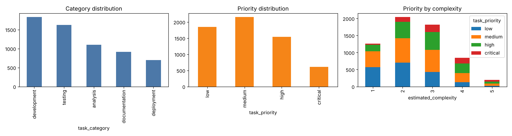
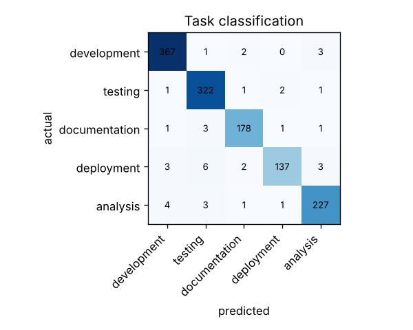
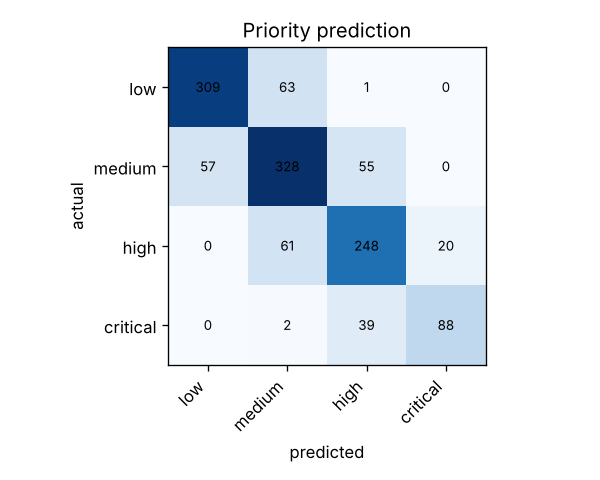
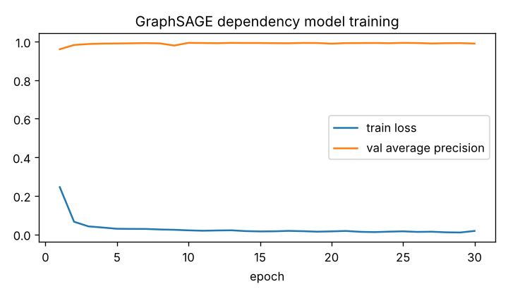
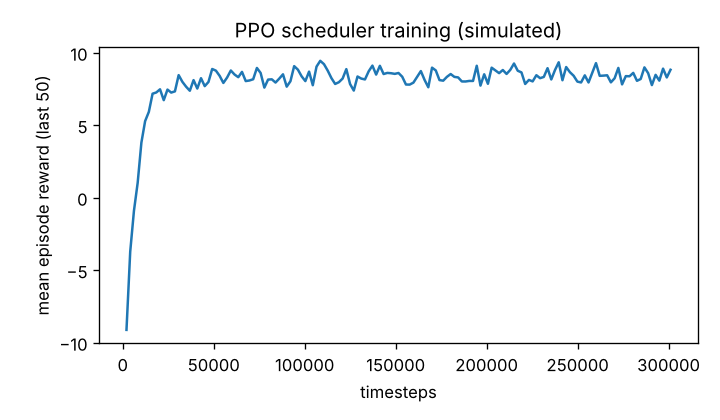
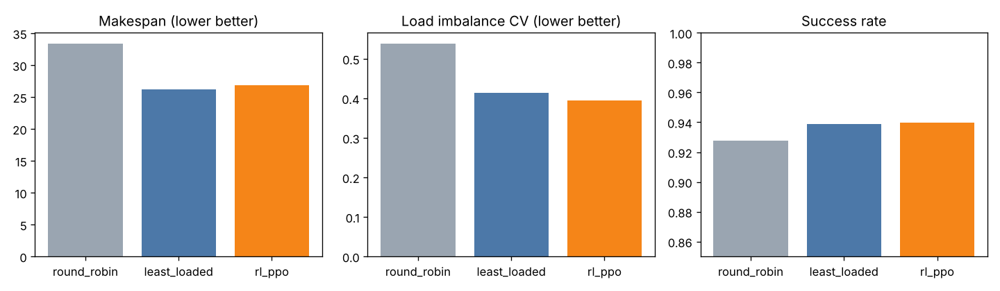
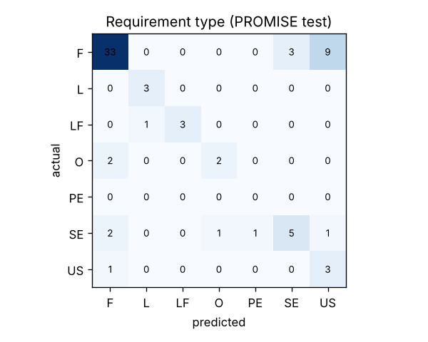
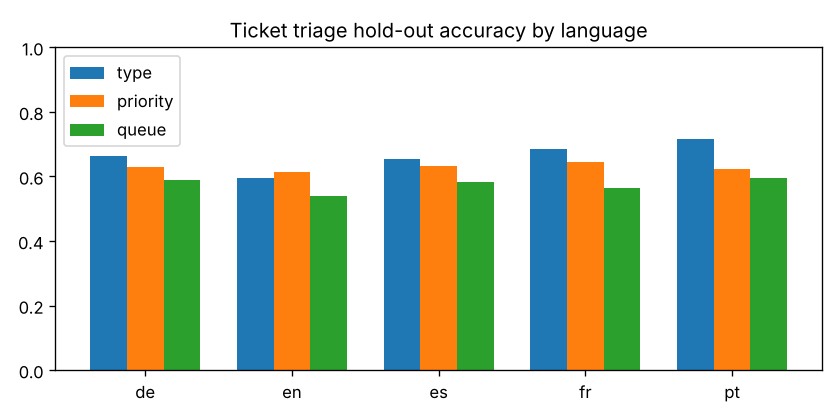

# Model Evaluation Report

> **Data provenance.** All results below come from the reproducible **synthetic** demonstration dataset (`app/ml/synthetic_data.py`, seed 42) and a **simulated** scheduling environment. They show that the pipeline trains and generalises to held-out synthetic projects; they are **not** measurements of real enterprise performance.

## 1. Dataset

| item | value |
|---|---|
| raw rows | 6354 |
| duplicates removed | 125 |
| empty descriptions removed | 60 |
| complexity values imputed (per-category median) | 237 |
| clean rows | 6169 |
| projects | 300 |
| train / val / test rows | 4286 / 612 / 1271 |
| split strategy | GroupShuffleSplit by `project_id` (project overlap train↔test: 0) |

Correlation of priority rank with features: `urgency` 0.579, `business_impact` 0.511, `estimated_complexity` 0.283, `num_dependents` 0.317

## 2. Task classification

GridSearchCV with 3-fold GroupKFold (grouped by project) on the training split; model selected on validation macro-F1, then refit on train+val and scored once on the test split.

| model | CV macro-F1 | val macro-F1 | val accuracy | best params | fit s |
|---|---|---|---|---|---|
| logistic_regression | 0.9747 | 0.9703 | 0.9722 | {"C": 0.5} | 6.4 |
| random_forest | 0.9711 | 0.9633 | 0.9673 | {"max_depth": 30, "n_estimators": 200} | 9.54 |
| gradient_boosting | 0.9698 | 0.9571 | 0.9608 | {"learning_rate": 0.1, "max_depth": 3, "n_estimators": 100} | 15.0 |

**Selected:** `logistic_regression` — **test accuracy 0.9685**, **test macro-F1 0.9645** (n=1271).

| class | precision | recall | F1 | support |
|---|---|---|---|---|
| development | 0.976 | 0.984 | 0.98 | 373 |
| testing | 0.961 | 0.985 | 0.973 | 327 |
| documentation | 0.967 | 0.967 | 0.967 | 184 |
| deployment | 0.972 | 0.907 | 0.938 | 151 |
| analysis | 0.966 | 0.962 | 0.964 | 236 |

## 3. Priority prediction

GridSearchCV with 3-fold GroupKFold (grouped by project) on the training split; model selected on validation macro-F1, then refit on train+val and scored once on the test split.

| model | CV macro-F1 | val macro-F1 | val accuracy | best params | fit s |
|---|---|---|---|---|---|
| logistic_regression | 0.7468 | 0.745 | 0.7516 | {"C": 0.3} | 0.8 |
| random_forest | 0.6392 | 0.6396 | 0.6699 | {"max_depth": 16, "min_samples_leaf": 2, "n_estimators": 300} | 8.27 |
| gradient_boosting | 0.7144 | 0.7303 | 0.7435 | {"learning_rate": 0.05, "max_depth": 3, "n_estimators": 150} | 47.18 |

**Selected:** `logistic_regression` — **test accuracy 0.7655**, **test macro-F1 0.7627** (n=1271).

| class | precision | recall | F1 | support |
|---|---|---|---|---|
| low | 0.844 | 0.828 | 0.836 | 373 |
| medium | 0.722 | 0.745 | 0.734 | 440 |
| high | 0.723 | 0.754 | 0.738 | 329 |
| critical | 0.815 | 0.682 | 0.743 | 129 |

## 4. Dependency prediction (directed edges)

Graphs: 210 train / 30 val / 60 test projects (test projects are the same held-out projects as above). Test ordered pairs: 26968, positive rate 0.069. Encoder: `tfidf_lsa`. Threshold chosen on validation.

| method | ROC-AUC | avg precision | precision | recall | F1 | threshold |
|---|---|---|---|---|---|---|
| GraphSAGE GNN (PyG) | 0.999 | 0.9923 | 0.9824 | 0.9591 | 0.9706 | 0.75 |
| NetworkX rule baseline | 0.676 | 0.1267 | 0.1763 | 0.5382 | 0.2656 | 0.5 |
| Cosine similarity only (tfidf_lsa) | 0.7135 | 0.1432 | - | - | - | - |

**Interpretation.** Similarity alone is a weak dependency signal (and cannot give direction). The GNN scores near-perfectly because synthetic dependencies follow consistent structural rules (setup → analysis → implement → test → integrate → deploy) that the model can learn; real project graphs are noisier, so expect substantially lower scores until it is retrained on labelled real data.

## 5. RL workload scheduling

PPO (stable-baselines3), 300,000 timesteps on SIMULATED workloads; evaluated on 200 unseen seeded episodes.

| scheduler | makespan | makespan std | load imbalance CV | success rate | invalid actions/ep | priority-weighted completion |
|---|---|---|---|---|---|---|
| round_robin | 33.3963 | 11.0497 | 0.5386 | 0.9277 | 0.0 | 16.2727 |
| least_loaded | 26.2066 | 7.5229 | 0.4141 | 0.9387 | 0.0 | 13.4817 |
| rl_ppo | 26.8372 | 7.8929 | 0.3946 | 0.9396 | 0.0 | 13.9938 |

**Verdict:** PPO did NOT beat the least-loaded heuristic on makespan; the orchestrator keeps least-loaded in 'auto' mode.

---

# Results on REAL data

## 6. Requirement-type classification (PROMISE NFR dataset)

Public PROMISE NFR corpus: 553 training statements (`nfr.txt`) and 70 test statements (`test.txt`) from **different projects**, so the test is cross-project. GridSearchCV (stratified 5-fold) on train; scored once on test. Features: word 1-2-gram + char 2-5-gram TF-IDF.

| task | selected model | CV macro-F1 | test accuracy | test macro-F1 | majority baseline acc. |
|---|---|---|---|---|---|
| Functional vs non-functional | logistic_regression | 0.9058 | 0.7857 | 0.7687 | 0.3571 |
| 12 requirement types | logistic_regression | 0.7223 | 0.7 | 0.5699 | 0.6429 |

Deployed model: refit on train+test (623 statements) after evaluation.

**Interpretation.** Cross-validation on the training projects scores clearly higher than the unseen test projects: requirement wording is project-specific, and security/operational statements phrased like 'only users with X access must be able to ...' are easily mistaken for functional ones. Rare classes (portability: 2 examples; legal and fault tolerance: 10 each) limit macro-F1.

## 7. Ticket triage (multilingual customer-support tickets)

4000 tickets in 5 languages (en: 1391, de: 848, es: 812, fr: 476, pt: 473). Stratified 80/20 split per target; GridSearchCV (stratified 5-fold) on the 80%. Features: language-agnostic char 3-5-gram + word 1-2-gram TF-IDF plus one-hot language; training augmented with subject-only copies.

| target | selected model | test accuracy | short (subject-only) accuracy | test macro-F1 | majority baseline acc. | accuracy by language |
|---|---|---|---|---|---|---|
| type | logistic_regression | 0.6462 | 0.6065 | 0.6442 | 0.4025 | de 0.6626, en 0.5965, es 0.6552, fr 0.686, pt 0.7174 |
| priority | logistic_regression | 0.6262 | 0.6248 | 0.5978 | 0.4125 | de 0.6303, en 0.6143, es 0.6333, fr 0.6442, pt 0.6238 |
| queue | logistic_regression | 0.5687 | 0.5057 | 0.5344 | 0.33 | de 0.5901, en 0.5401, es 0.5824, fr 0.5638, pt 0.5941 |

**Design ablation.** Removing the business-type feature and training on subject-only copies trades a little full-text accuracy for clearly better accuracy on one-line tickets (the common real-world case):

| target | previous full-text acc. | current full-text acc. | previous short acc. | current short acc. |
|---|---|---|---|---|
| type | 0.6613 | 0.6462 | 0.5781 | 0.6065 |
| priority | 0.6262 | 0.6262 | 0.5314 | 0.6248 |
| queue | 0.5962 | 0.5687 | 0.4957 | 0.5057 |

_CV scores of the current model are optimistic because subject-only copies of a ticket can fall in different CV folds; reported test numbers use an untouched hold-out._

**Interpretation.** All three models beat the majority baseline by a wide margin and work across all five languages. Priority is partly subjective (similar wording appears with different priorities), which caps accuracy; queue confusions are mostly between overlapping teams (Technical / Product / IT Support).

